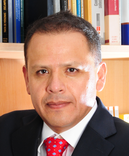

::: {.course-hero}

{style="float:right; margin-left:2rem; margin-top:0.5rem;" fig-alt="Logo del curso Procesos Laborales" width="220"}

# Procesos Laborales

## Derecho Procesal del Trabajo

Posgrado — PUCP y UNMSM · Prof. Paul Paredes

::: {.course-hero-actions}
[→ Ver clases 2026-II](lectures-2026-2.qmd){.btn-hero-primary}
[Cursos anteriores](cursos/2026-1.qmd){.btn-hero-outline}
:::

:::

:::{.callout-note}
## Semestre 2026-II — Maestría en Derecho Procesal (PUCP)

Esta página agrupa los materiales del curso de Procesos Laborales que el prof. Paul Paredes dicta en la **Maestría en Derecho del Trabajo y de la Seguridad Social (PUCP)** y en las **maestrías en Derecho Procesal de la PUCP y de la UNMSM**. En el semestre **2026-II** el curso se dicta en la **Maestría en Derecho Procesal de la PUCP** (DPR623), en dos módulos. Los semestres anteriores están en el menú *Cursos anteriores*.
:::

<!-- Ficha del semestre vigente: al cambiar de semestre basta cambiar esta línea -->



---

## Profesor

{style="float:right;padding: 0 0 0 10px;" fig-alt="Headshot de Paul Paredes" width="200"}

[**Mg. Paul Paredes**](https://paulparedes.pe/) es abogado litigante en causas de trabajadores y sindicatos. Asimismo, es profesor de derecho procesal del trabajo en la Maestría en Derecho del Trabajo y de la Seguridad Social de la Pontificia Universidad Católica del Perú y en las maestrías en Derecho Procesal de la Pontificia Universidad Católica del Perú y de la Universidad Nacional Mayor de San Marcos. Es miembro de la Red Latinoamericana de Epistemología Jurídica promovida por la Universidad de los Andes, Colombia. Paul cuenta con tres maestrías. Es maestro en Política Jurisdiccional por la PUCP (Lima, 2006); máster en Argumentación Jurídica por las universidades de Alicante y Palermo (España, Italia 2016); y máster en Razonamiento Probatorio por las universidades de Girona y Génova (España, Italia 2019). Es autor del libro *Prueba y presunciones en el proceso laboral* (ARA editores, Lima, 1997). Ha publicado el texto "El principio de facilitación probatoria en el proceso laboral" dentro de la obra colectiva *Del derecho al razonamiento probatorio* (Marcial Pons, Madrid, 2020), así como el artículo "El uso de la prueba científica por parte de la Suprema Corte de Justicia de la Nación en materia laboral" en la investigación colectiva *Ciencia y justicia* (Centro de Estudios Constitucionales, México, 2021). Su línea de investigación es el proceso laboral, la teoría de la prueba y el razonamiento probatorio.

&ensp;
&ensp;
&ensp;

<!--Include social share buttons-->


